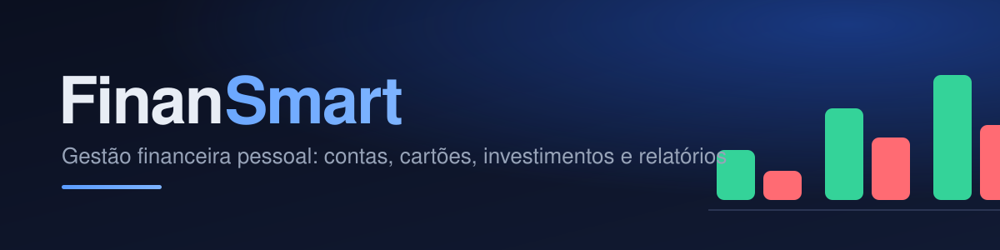

  

# 💰 FinanSmart

Plataforma pessoal de gestão financeira — contas, cartões de crédito, gastos fixos, investimentos, orçamentos, metas e relatórios, tudo em um só lugar, com login e sincronização entre dispositivos.

  

<!-- Para mostrar uma prévia: salve um print do dashboard como preview.png neste repositório e remova as marcas de comentário abaixo.

  

-->

## 🔗 Acesse aqui

**[https://edutiton04.github.io/Finansmart/](https://edutiton04.github.io/Finansmart/)**

## ✨ Funcionalidades

- **Dashboard** com saldo disponível, receitas, despesas, resultado do mês, faturas em aberto, investimentos e patrimônio líquido, com gráficos e navegação mês a mês
- **Movimentações** de receitas, despesas e transferências, com categorias, filtros e **comprovantes** anexados (JPEG, PNG ou PDF)
- **Importação de planilhas** (.xlsx e .csv) com conferência antes de gravar e proteção contra lançamentos duplicados
- **Contas bancárias** com saldo calculado e transferências que não viram receita nem despesa
- **Cartões de crédito** com limite, fechamento e vencimento, compras parceladas distribuídas nas faturas futuras e pagamento de fatura sem duplicar gastos
- **Gastos fixos e assinaturas** com controle de pago, pendente e atrasado em cada mês
- **Investimentos** com aportes, resgates e rendimentos fora das despesas, rentabilidade e evolução do patrimônio
- **Orçamentos** por categoria com alertas de limite e **metas** com prazo e valor mensal sugerido
- **Relatórios** com histórico de 12 meses, gastos por categoria, **exportação em PDF** e **projeção de fluxo de caixa** para os próximos 6 meses
- Backup e restauração (dados e comprovantes), tema claro e escuro e layout responsivo para computador e celular

## 🛠️ Tecnologia

HTML, CSS e JavaScript puro, sem etapa de build e sem dependências. **Firebase Auth/Firestore** para login e sincronização de conta (um documento por item, gravando só o que mudou, com regras que isolam os dados de cada usuário), **localStorage** e **IndexedDB** como suporte local e para os comprovantes. Hospedado no **GitHub Pages**, sem back-end próprio e sem custo. Os valores são calculados em centavos para evitar erros de arredondamento.

## 🚀 Como rodar

- **Modo local, sem login:** deixe o `firebase-config.js` com os valores originais e abra o `index.html`.
- **Com login e sincronização:** crie um projeto no Firebase e siga o passo a passo do [FIREBASE.md](./FIREBASE.md). O login precisa ser testado por `http://localhost` ou pelo GitHub Pages, não abrindo o arquivo diretamente.
- **Publicar:** envie os arquivos para um repositório público e ative o GitHub Pages em *Settings → Pages* (branch `main`, pasta `/ (root)`).

> ⚠️ Nunca envie arquivos de backup (`finansmart-backup-*.json`) para o repositório: eles contêm os seus dados.

## 📌 Roadmap

- [ ] Funcionamento offline completo, com sincronização ao reconectar
- [ ] Metas ligadas a investimentos reais
- [ ] Sincronização de comprovantes entre dispositivos

---

Projeto pessoal de gestão financeira — construído e mantido por <a href="https://github.com/edutiton04">@edutiton04</a>.

